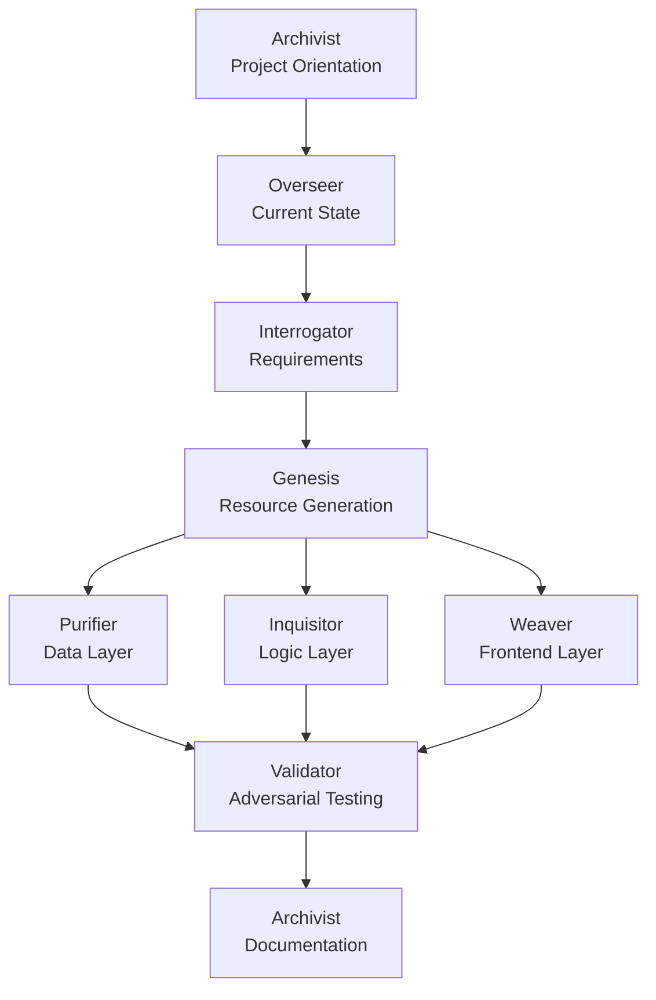
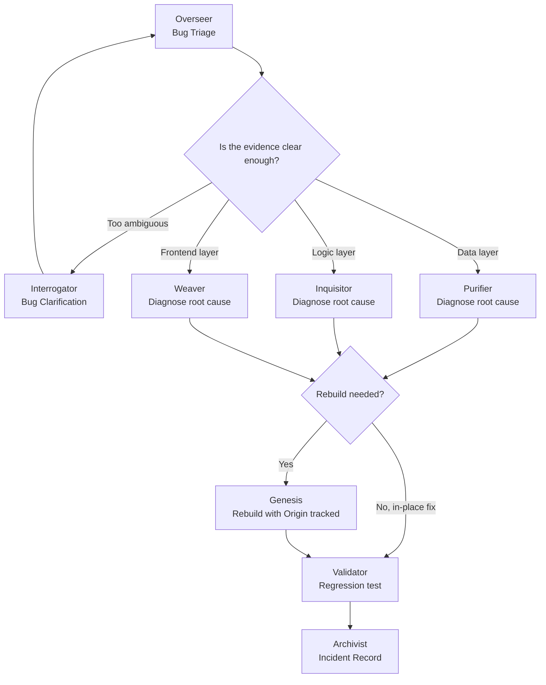

# EVE Skill Suite — Ecosystem Vitality Engines for Palantir Foundry

8 specialized Claude Code Skills covering the full Foundry project lifecycle — from requirement clarification to build, QA, documentation, ongoing drift monitoring, bug triage, resource cleanup, and data governance. Each skill is self-contained and can be used independently, with no cross-skill dependencies at runtime.

**English** | [繁體中文](./README.zh-TW.md)

---

## Prerequisites

- For use in AI FDE environments
- [Claude Code](https://claude.ai/code) CLI installed
- A Palantir Foundry environment (for actually deploying generated artifacts)
- Basic familiarity with Foundry concepts (Object Types, Action Types, Workshop, etc.)

---

## Installation

```bash
npx skills add github:q0015300153/eve-skills
```

**Verify** the installation:

```bash
npx skills list
```

All 8 `eve-*` skills should appear in the output.

**Update** to the latest version:

```bash
npx skills update eve-skills
```

**Remove:**

```bash
npx skills remove eve-skills
```

**Alternative — manual clone** (if you prefer to manage the files yourself):

```bash
git clone https://github.com/q0015300153/eve-skills.git
```

Then paste the content of any `skills/<skill-name>/SKILL.md` into your Foundry AIP Logic / Chatbot Studio system prompt configuration.

---

## Skills

| Skill | Full Name | What it does |
|---|---|---|
| `eve-interrogator` | Elucidation Vector Engine | Interrogator: Resolves every relevant dimension, but only *asks* about the ones that genuinely have no safe default. Anything the project already answers is stated as **`[KNOWN]`** and never asked; anything with a defensible default becomes a one-line **`[ASSUMED]`** you override in a word; only real blockers get a full multiple-choice question. The `[DECISION RECORD]` is a payload for downstream skills, emitted once at handoff — short form when the receiver can read the conversation, full form when it can't. When a bug report is too vague to route, switches to a dedicated symptom-clarification quiz to scope it before handing off to a specialist. |
| `eve-overseer` | Ecosystem Visibility Engine | Overseer: Runs a **mandatory live resource scan (STEP 0) before every response, in every mode** — reporting less is a formatting choice, scanning less is a correctness failure. States status in a few lines, then spends the response on what to do next, presenting **options with their consequences** wherever more than one defensible path exists. Unchanged tasks collapse to one line so the roadmap doesn't reprint itself every turn. Also scans the whole project for unused resources, and triages bug reports to the right specialist on evidence rather than symptom wording. |
| `eve-genesis` | Entity Vivification Engine | Genesis: From any use case, data schema, or business requirement, generates complete, deployable Foundry resources from scratch. The confirmed Tier Map becomes the **`[BLUEPRINT OF RECORD]`** written into the TIER 0 proposal description, so a build that pauses for days — and every downstream skill — can still read the contract. Scopes fields to what's actually needed, flags fields that look sensitive by naming pattern, re-reads whether a proposal has since merged or a version has since been pinned instead of repeating stale status, and keeps full root-cause traceability when the build is fixing a known bug — delivered one Tier at a time. |
| `eve-purifier` | Entity Viability Engine | Purifier: The data quality **and** exposure gatekeeper — every response opens with **two independent verdicts**: safe to index, and safe to expose. Sets up strict health checks to block corrupted, duplicate, or garbage data, and provides a formal classification level plus Marking/row-column security recommendations for any flagged field. The schema contract and every classification decision are written to the dataset's or Object Type's **`[CONTRACT OF RECORD]`** — a compliance decision that exists only in a chat log cannot be audited. Re-reads whether a recommended control is actually in place before demanding it again. |
| `eve-inquisitor` | Entropy Vanguard Engine | Inquisitor: A merciless code review bot that hunts down inefficient, low-quality code and forces optimization backed by real evidence. Leads with a scannable severity table carrying each finding's **status** (fixed on the branch · you must apply · needs your decision · optional · resolved by you), expands only what demands action, and shows rewrites as **minimal diffs rather than whole files**. Re-audits report the delta, not the same table again. When investigating a specific bug, keeps the original symptom traceable all the way through to a confirmed fix. |
| `eve-weaver` | Experience Visualization Engine | Weaver: Designs zero-latency UIs across Workshop, Slate, and OSDK (TypeScript v2). **Builds everything module editing can reach** — routing a buildable item into a manual instruction is a defect, not a safe default. The few genuinely manual steps go into an **operator note inside the module**, which contains only what the person clicking can actually tick off; the audit trail (states, latency figures, risks, cleanup candidates) goes into the **module's resource documentation**, where downstream skills can find it. Runs a mandatory **STEP 0 live scan** so a merged proposal is never reported as still awaiting you, and requires explicit confirmation before wiring any field that looks sensitive into the UI. |
| `eve-validator` | Execution Validation Engine | Validator: Writes extreme test cases and fake data to actively try to "break" your code. Attack vectors include a **permission boundary** test — requesting a protected value as a role that should be denied, through **both Workshop and OSDK**, because a field filtered out of a widget can still come back through a query. Passing tests collapse to a count; failures and **`[UNVERIFIED]`** boundaries are reported in full, because an untested boundary silently reads as a safe one. The deployment gate and every accepted risk live in a **`[GATE RECORD]`** file, not in the chat. Once a regression test confirms a reported bug is fixed, flags it distinctly and hands it to the Archivist. |
| `eve-archivist` | Encyclopedic Vault Engine | Archivist: Orients newcomers in a project — reads it live and delivers the full inventory, architecture map, Ontology map, and current health in one pass. On request, writes a paired Notepad and Solution Design diagram into Foundry. Also deciphers undocumented code into clear documentation — **annotated code is committed to its repository** — flags existing documentation this pass proves wrong, and defers to official documentation rather than guessing at platform-level facts. The final record-keeper for the debug workflow, preserving the symptom, root cause, fix, and regression test in an `[INCIDENT RECORD]` once a fix is validated. |

---

## Where each skill writes

Anything whose entire value is being findable later cannot live in a conversation. Each skill has a durable destination, chosen for **who reads it**:

| Skill | Writes to |
|---|---|
| `eve-genesis` | **`[BLUEPRINT OF RECORD]`** → the TIER 0 proposal description (fallback: project resource documentation or a Notepad) · code → a repository |
| `eve-purifier` | **`[CONTRACT OF RECORD]`** → the dataset's or Object Type's resource documentation (fallback: a Notepad) · validation/quarantine code → the transform file |
| `eve-weaver` | **Operator note widget** → inside the module, operator-clickable steps only · **audit trail** → the module's resource documentation · component/function code → a repository |
| `eve-validator` | **`[GATE RECORD]`** → `tests/GATE.md` beside the suite, or the component's resource documentation · test suites → a repository |
| `eve-archivist` | Resource documentation · a Notepad when a record spans several resources · annotated code → its repository |
| `eve-inquisitor` | Optimized code → a branch/PR |
| `eve-interrogator` | Nothing directly — routes its `[DECISION RECORD]` downstream, and to `eve-archivist` when it must outlive the session |
| `eve-overseer` | Nothing — read-only |

A destination is only correct if its **audience** is right. The operator note is a widget every module viewer sees, so it holds only steps that reader can complete and then delete; findings, risks, and snapshot figures belong in the documentation instead.

---

## Lifecycle Flow



---

## Debug Workflow

When a project is already live and something breaks, the path is different from starting a build from scratch:



`eve-overseer` is the only skill spanning every platform layer, making it the natural entry point for bug reports. If its own Drift Audit already explains the symptom (e.g. Action Type version drift), it resolves it directly rather than routing elsewhere.

---

## Cleanup & Data Governance

Beyond the main build pipeline, the family has two standing guardrails:

- **Unused resource cleanup** — `eve-overseer` scans **across the whole project** (Datasets, Transforms, Object Types, Link Types, Functions, Action Types, Automate Rules, Workshop Modules, OSDK Packages, Branches/Proposals), while `eve-weaver` scans **within a single Workshop module** (variables and widgets). The two are complementary and never overlap — both only ever surface recommendations, never delete automatically, and each recommendation states what deleting would break and what keeping it costs.

- **Sensitive data protection chain** — four steps, each with a different job:
  1. **`eve-genesis`** flags fields matching sensitive naming patterns (`ssn`, `password`, `salary`, …) and requires an explicit Include/Exclude decision at build time.
  2. **`eve-purifier`** assigns a formal classification level (Public / Internal / Confidential / Restricted) plus Marking/row-column security recommendations, recorded in the Contract of Record.
  3. **`eve-weaver`** cross-checks again before wiring any such field into a Workshop widget or OSDK query — and says plainly that inspecting a display choice never proves a control holds.
  4. **`eve-validator`** proves it, by requesting the value as a role that should be denied, through both Workshop and OSDK. **A control's configuration never proves its effect** — steps 1–3 recommend and inspect; only step 4 verifies.

  Never a silent exposure at any step.

---

## Design Principles

- **RIDs are always rendered in native format**: use `:resource[rid]` syntax — never plain text or generic Markdown links.
- **State is read, not remembered.** No skill reports a proposal as open, a function as unpublished, a version as unpinned, or a control as unapplied based on what it did earlier in the conversation — people merge, publish, and delete outside the session, often on another day. `eve-overseer` and `eve-weaver` formalize this as a **mandatory STEP 0 live scan** with an explicit per-resource query list; the others enforce it as a standing rule before any status claim. Reporting less is a formatting choice; scanning less is a correctness failure.
- **Anything that must outlive the conversation is written down.** Blueprints, schema contracts, classification decisions, deployment gates, accepted risks, incident records, and audit trails all have a destination — a proposal description, resource documentation, a Notepad, or a repository file. A record that dies with the chat has failed its one job, and a "locked" decision nobody wrote down gets silently re-assumed next session.
- **A destination is only correct if its audience is right.** The Workshop operator note is a widget every module viewer sees, so it holds only steps that reader can tick off and then delete — never risks, rationale, internal names, or figures that decay. Anything with a different reader goes somewhere else.
- **No skill automatically invokes another**: `[WORKFLOW HANDOFF]` is advisory only — the human decides whether to switch. Every pointer carries the figure, cause, or specific gap the receiving skill needs, or names where it lives — never a bare "needs a performance audit".
- **Every Dead Reckoning requires explicit user acknowledgment**, with all assumed values flagged — never silently assuming state is unchanged.
- **Two distinct kinds of uncertainty**: `[⚠️ INFERRED]` means "a best guess from available evidence"; `[⚠️ VERIFY IN DOCS]` means "the platform mechanic itself isn't confidently known — check official documentation." The family never conflates the two, and never substitutes a guessed step for an honest "verify this yourself."
- **Report what needs acting on.** Passing checks become a count, unchanged findings collapse to one line, a rewrite shows changed lines rather than a whole file, and a decision the user already made is never replayed — only its *invalidation* is news. But **brevity never hides a gap**: coverage is stated explicitly, and nothing the user has to act on is ever trimmed to make a report shorter (manual configuration fields and deployment gate evidence are always shown in full).
- **Actions live in one place.** Anything only the user can do — apply, decide, verify, confirm, redo — appears in a single `[NEEDS YOU]` list, never buried in a findings table or a template. A finding diagnoses; it does not also carry a to-do list.
- **Sensitive data is never silently exposed**: any field matching a sensitive naming pattern — or previously flagged — requires explicit confirmation before it's wired into anything user-facing, and **is not considered protected until an adversarial test proves the control holds**.
- **Markdown integrity is part of correctness.** Every fence closed, every table row with its full column count, every record complete. These skills write into notes, documentation, and repository files that other people and other sessions read — a truncated table silently drops a field's rule, and a truncated gate record loses an accepted risk.

---

## Traditional Development Version

Looking for the same skill suite for **general software development** (web systems, CLI tools, databases, servers, etc.) without Palantir Foundry?
A platform-agnostic port is maintained at **[q0015300153/nova-skills](https://github.com/q0015300153/nova-skills)**.

---

## Contributing

Pull requests are welcome. Each skill lives in `skills/<skill-name>/SKILL.md` and is fully self-contained — no cross-skill dependencies at runtime.

---

## License

[MIT](./LICENSE)
