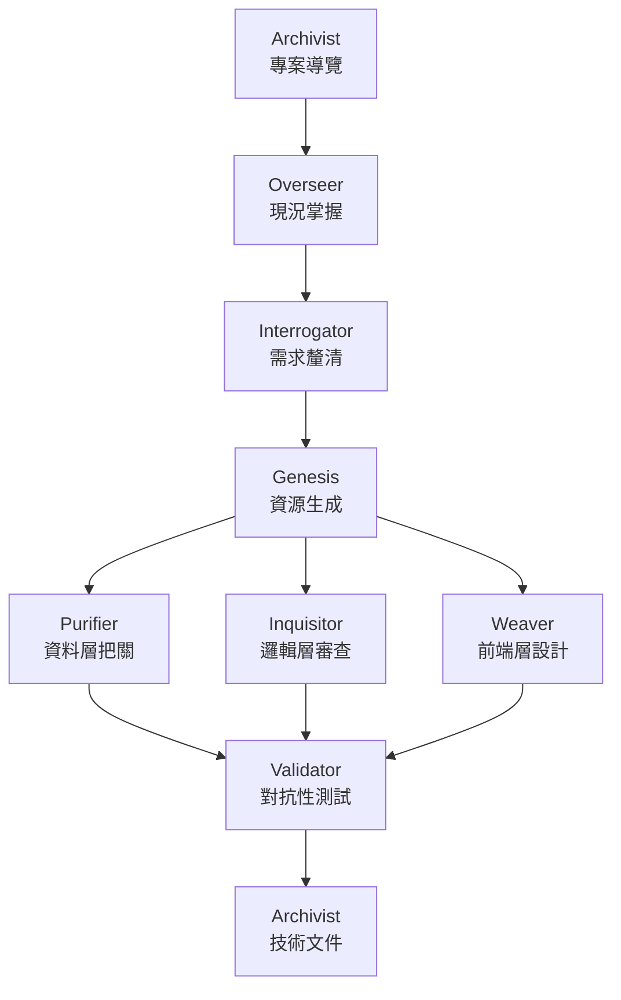
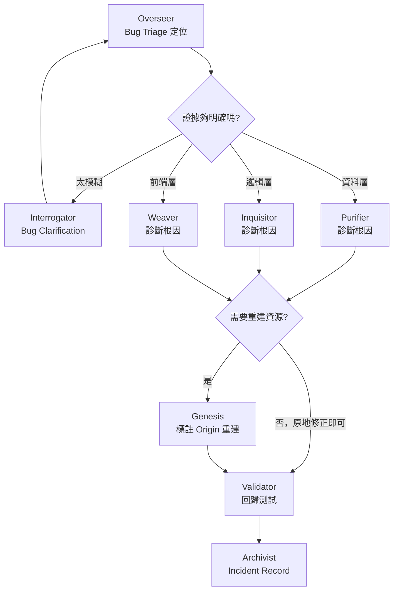

# EVE Skill Suite — Palantir Foundry 生態系活力引擎 (Ecosystem Vitality Engines)

8 個專業化的 Claude Code Skill，涵蓋 Foundry 專案的完整生命週期——從需求釐清、建置、QA、文件撰寫，到日常的版本飄移監控、Bug 分流除錯、資源清理與資料安全治理。每個 Skill 均為自包含設計，可獨立使用，執行階段不存在跨 Skill 的依賴關係。

[English](./README.md) | **繁體中文**

---

## 使用前提

- 用於 AI FDE 環境
- 已安裝 [Claude Code](https://claude.ai/code) CLI
- 具備 Palantir Foundry 環境（用於實際部署所生成的資源）
- 對 Foundry 基本概念有基礎認識（Object Type、Action Type、Workshop 等）

---

## 安裝

```bash
npx skills add github:q0015300153/eve-skills
```

**驗證**安裝是否成功：

```bash
npx skills list
```

應可在輸出中看到所有 8 個 `eve-*` Skill。

**更新**至最新版本：

```bash
npx skills update eve-skills
```

**移除：**

```bash
npx skills remove eve-skills
```

**替代方案 — 手動 clone**（適合希望自行管理檔案的場景）：

```bash
git clone https://github.com/q0015300153/eve-skills.git
```

然後將任意 `skills/<skill-name>/SKILL.md` 的內容貼入 Foundry AIP Logic / Chatbot Studio 的系統提示詞設定中。

---

## Skill 一覽

| Skill | 全名 | 職責 |
|---|---|---|
| `eve-interrogator` | Elucidation Vector Engine | 審訊者：解析每一個相關維度，但只*詢問*那些真正沒有安全預設值的項目。凡是專案本身已能回答的，標示為 **`[KNOWN]`** 不再詢問；凡是有合理預設值的，用一行 **`[ASSUMED]`** 供你在一個字內覆蓋；只有真正的阻礙項才會給出完整的多選題。`[DECISION RECORD]` 是交付給下游 Skill 的載體，在交接時發出一次——接收方能讀取對話時用簡短格式，不能時用完整格式。當 Bug 回報太模糊無法分流時，切換為專屬的症狀釐清問卷，先確定範疇再交給對應專家。 |
| `eve-overseer` | Ecosystem Visibility Engine | 監督者：**每次回應、每種模式下都必須執行即時資源掃描（STEP 0）**——少報是排版選擇，少掃是正確性失敗。用幾行說明現況，其餘篇幅聚焦於下一步該做什麼，凡有超過一條合理路徑的地方，呈現**選項及其後果**供選擇。未變更的任務折疊為一行，讓路線圖不在每次回應中重複印出。同時掃描整個專案的無用資源，並根據證據而非症狀措辭將 Bug 分流到正確的專家。 |
| `eve-genesis` | Entity Vivification Engine | 創世紀：從任何使用情境、資料 Schema 或商業需求出發，從零生成完整、可直接部署的 Foundry 資源。確認後的 Tier Map 成為寫入 TIER 0 提案描述的 **`[BLUEPRINT OF RECORD]`**，讓暫停數天的建置——以及所有下游 Skill——都能讀到合約。欄位只納入實際需要的項目，用命名模式標記疑似機敏資料，重新讀取提案是否已合併或版本是否已釘選，而不是重複報告過時狀態，並在修復已知 Bug 時保留完整的根因追溯鏈——一次一個 Tier 分段交付。 |
| `eve-purifier` | Entity Viability Engine | 淨化者：資料品質**與**曝露守門員——每次回應開頭給出**兩個獨立裁決**：可安全索引，以及可安全曝露。設置嚴格的健康檢查阻止損壞、重複或垃圾資料，並針對任何被標記的欄位提供正式分類等級與 Marking / Row-Column Security 建議。Schema 合約與所有分類決策寫入資料集或 Object Type 的 **`[CONTRACT OF RECORD]`**——僅存在於聊天記錄中的合規決策無法被稽核。在再次要求前，重新讀取建議的控制是否已實際到位。 |
| `eve-inquisitor` | Entropy Vanguard Engine | 審判官：無情的程式碼審查機器人，專門獵殺低效、劣質程式碼，並強制以真實證據為基礎的最佳化。以可快速掃描的嚴重度表格開頭，每個發現都標注**狀態**（已在分支修復・你必須套用・需要你的決策・可選・你已解決），只展開真正需要行動的項目，以**最小差異而非整個檔案**顯示改寫。重新稽核時只報告差異，不重複同一張表格。接手特定 Bug 調查時，全程保留原始症狀的追溯鏈直到修復確認完成。 |
| `eve-weaver` | Experience Visualization Engine | 織造者：設計零延遲的 Workshop、Slate 和 OSDK (TypeScript v2) UI。**建置所有模組編輯能觸及的內容**——將可建置項目導入手動說明是缺陷，不是安全的預設行為。少數真正手動的步驟放入**模組內的 operator note widget**，其中只包含操作人員可以實際勾選的步驟；稽核記錄（狀態、延遲數字、風險、清理候選）放入**模組的資源說明文件**，供下游 Skill 查找。執行強制性的 **STEP 0 即時掃描**，確保已合併的提案不被報告為仍在等待，並在把任何疑似機敏欄位接入 UI 前要求明確確認。 |
| `eve-validator` | Execution Validation Engine | 驗證者：撰寫極端測試案例與假資料，主動嘗試「摧毀」你的程式碼。攻擊向量包含**權限邊界**測試——以應被拒絕的角色透過 **Workshop 和 OSDK 兩個管道**請求受保護的值，因為從 widget 過濾掉的欄位仍可能從查詢中傳回。通過的測試折疊為計數；失敗的測試與 **`[UNVERIFIED]`** 邊界則完整報告，因為未測試的邊界會被默默視為安全邊界。部署閘門與所有已接受的風險存放在 **`[GATE RECORD]`** 檔案中，不在聊天裡。一旦回歸測試確認某個回報過的 Bug 已修復，會明確標記並交由 Archivist 記錄。 |
| `eve-archivist` | Encyclopedic Vault Engine | 銘記者：為新成員提供專案導覽——即時讀取專案，在一次回應中交付完整資源清單、架構圖、Ontology 圖與當前健康狀態。有需要時，將成對的 Notepad 和 Solution Design 圖寫入 Foundry。同時解讀未文件化的程式碼，轉譯為清晰文件——**注釋程式碼提交到其所在的儲存庫**——標記本次掃描所證明的既有文件錯誤，並以官方文件為準，不對平台級事實進行猜測。整個除錯流程的最終記錄站，在修復確認後，以 `[INCIDENT RECORD]` 完整保存症狀、根因、修復內容與回歸測試依據。 |

---

## 每個 Skill 寫入的位置

任何價值在於「日後可被找到」的內容，不能停留在對話中。每個 Skill 都有一個耐久的目的地，根據**誰來閱讀**來決定：

| Skill | 寫入位置 |
|---|---|
| `eve-genesis` | **`[BLUEPRINT OF RECORD]`** → TIER 0 提案描述（備選：專案資源說明文件或 Notepad）· 程式碼 → 儲存庫 |
| `eve-purifier` | **`[CONTRACT OF RECORD]`** → 資料集或 Object Type 的資源說明文件（備選：Notepad）· 驗證/隔離程式碼 → transform 檔案 |
| `eve-weaver` | **Operator note widget** → 模組內部，僅放操作人員可勾選的步驟 · **稽核記錄** → 模組的資源說明文件 · 元件/函式程式碼 → 儲存庫 |
| `eve-validator` | **`[GATE RECORD]`** → 測試套件旁的 `tests/GATE.md`，或元件的資源說明文件 · 測試套件 → 儲存庫 |
| `eve-archivist` | 資源說明文件 · 橫跨多個資源的記錄時用 Notepad · 注釋程式碼 → 其所在儲存庫 |
| `eve-inquisitor` | 最佳化後的程式碼 → branch/PR |
| `eve-interrogator` | 不直接寫入——將其 `[DECISION RECORD]` 路由至下游，並在需要跨越會話存活時交給 `eve-archivist` |
| `eve-overseer` | 不寫入——唯讀 |

目的地正確與否，取決於**受眾是否正確**。Workshop operator note 是模組所有檢視者都能看到的 widget，因此只放操作人員可以完成後刪除的步驟；發現、風險和快照數字應放在說明文件中。

---

## 生命週期流程



---

## Debug 工作流

當專案已經上線、有人回報「東西壞了」時，走的是另一條路徑，而不是從頭重新建置：



`eve-overseer` 是唯一橫跨全部平台層級的 Skill，因此是 Bug 回報的天然入口；如果它自己的 Drift Audit 就能解釋症狀（例如 Action Type 版本漂移），會直接就地解決，不會多繞一手交給其他 Skill。

---

## 清理與資料治理

除了主線建置流程，家族內建兩種持續性的守護機制：

- **無用資源清理**——`eve-overseer` 負責**全專案跨資源**掃描（Dataset、Transform、Object Type、Link Type、Function、Action Type、Automate Rule、Workshop Module、OSDK Package、Branch/Proposal 都涵蓋），`eve-weaver` 負責**單一 Workshop 模組內部**的變數/元件清理，兩者互補、不重疊——都只列出建議，絕不自動刪除，且每條建議都說明刪除會造成什麼影響、保留的代價是什麼。

- **機敏資料防護鏈**——四個步驟，各有不同的職責：
  1. **`eve-genesis`** 在建置時以命名模式（`ssn`、`password`、`salary`……）主動標記疑似機敏欄位，並要求明確的 Include/Exclude 決策。
  2. **`eve-purifier`** 指派正式的分類等級（Public / Internal / Confidential / Restricted）以及 Marking / Row-Column Security 建議，記錄在 Contract of Record 中。
  3. **`eve-weaver`** 在把任何欄位接進 Workshop Widget 或 OSDK 查詢前再次交叉確認，並明確指出檢查顯示選項絕不等於控制有效。
  4. **`eve-validator`** 加以驗證——以應被拒絕的角色，透過 Workshop 和 OSDK 兩個管道請求該值。**控制的設定從來不能證明其效果**——步驟 1–3 負責建議與檢查；只有步驟 4 能驗證。

  每個步驟都不存在靜默曝露。

---

## 設計原則

- **RID 永遠以原生格式呈現**：使用 `:resource[rid]` 語法，而非純文字或一般 Markdown 連結。
- **狀態是讀取的，不是記憶的。** 沒有任何 Skill 會根據本次會話早些時候做了什麼，就報告提案為開放、函式為未發布、版本為未釘選或控制為未套用——人們會在會話外合併、發布和刪除，往往在另一天。`eve-overseer` 和 `eve-weaver` 將此正式化為**強制性 STEP 0 即時掃描**，附帶明確的逐資源查詢清單；其他 Skill 在任何狀態聲明前都強制執行此規則。少報是排版選擇；少掃是正確性失敗。
- **任何必須在對話後存活的內容都要寫下來。** 藍圖、Schema 合約、分類決策、部署閘門、已接受的風險、事件記錄和稽核記錄，都有各自的目的地——提案描述、資源說明文件、Notepad 或儲存庫檔案。隨著聊天消失的記錄未完成其唯一的職責；沒有人寫下的「已鎖定」決策，下次會話中會被默默重新假設。
- **目的地正確與否，取決於受眾是否正確。** Workshop operator note 是模組所有檢視者都能看到的 widget，因此只放操作人員可以勾選後刪除的步驟——絕不放風險、理由、內部名稱或會過期的數字。受眾不同的內容放到其他地方。
- **Skill 不會自動呼叫另一個 Skill**：`[WORKFLOW HANDOFF]` 僅為建議指示，需由人工決定是否切換。每個指標都攜帶接收 Skill 所需的數字、原因或具體缺口，或指明其所在位置——絕不只是一句空泛的「需要效能稽核」。
- **每個推算（Dead Reckoning）都需明確用戶確認**，且所有假設值均會標記旗標，絕不靜默假設狀態未變。
- **兩種不確定性明確區分**：`[⚠️ INFERRED]` 代表「從現有證據推測的最佳猜測」；`[⚠️ VERIFY IN DOCS]` 代表「平台機制本身不確定——請查官方文件」。全家族統一使用這組標記，絕不混用，也絕不用猜測的操作步驟取代誠實的「請自行確認」。
- **只報告需要行動的內容。** 通過的檢查折疊為計數，未變更的發現折疊為一行，改寫顯示變更的行而不是整個檔案，用戶已做的決策不再重播——只有其*失效*才是新聞。但**精簡絕不掩蓋缺口**：涵蓋範圍明確說明，任何用戶需要行動的內容都不會為了讓報告更短而被刪減（手動設定欄位和部署閘門的證據始終完整顯示）。
- **行動集中在一個地方。** 只有用戶能做的事——套用、決定、驗證、確認、重做——都出現在單一的 `[NEEDS YOU]` 清單中，不埋在發現表格或範本裡。發現負責診斷；不兼帶待辦清單。
- **機敏資料絕不靜默曝露**：任何符合機敏命名模式（或曾被標記過）的欄位，在被接進使用者看得到的介面之前，一律要求明確確認，且**在對抗性測試證明控制有效之前，不視為受保護**。
- **Markdown 完整性是正確性的一部分。** 每個 fence 閉合，每個表格列有完整的欄位數，每條記錄完整。這些 Skill 寫入的是其他人和其他會話都會讀到的 Note、文件和儲存庫檔案——截斷的表格會靜默丟失欄位的規則，截斷的閘門記錄會丟失已接受的風險。

---

## 傳統開發版本

如果你需要在**傳統軟體開發**環境（網頁系統、終端機程式、資料庫、伺服器等）中使用相同的 Skill 套件，而不依賴 Palantir Foundry，
平台無關移植版本維護於 **[q0015300153/nova-skills](https://github.com/q0015300153/nova-skills)**。

---

## 貢獻

歡迎提交 Pull Request。每個 Skill 位於 `skills/<skill-name>/SKILL.md`，完全自包含——執行階段不存在跨 Skill 的依賴關係。

---

## 授權

[MIT](./LICENSE)
